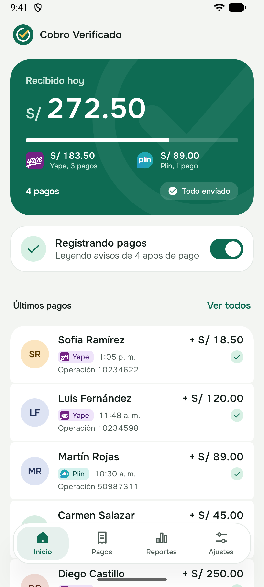
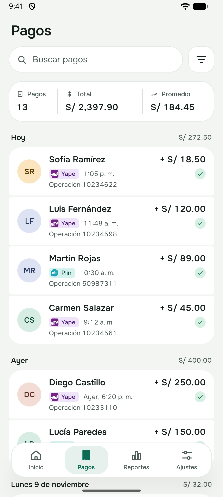
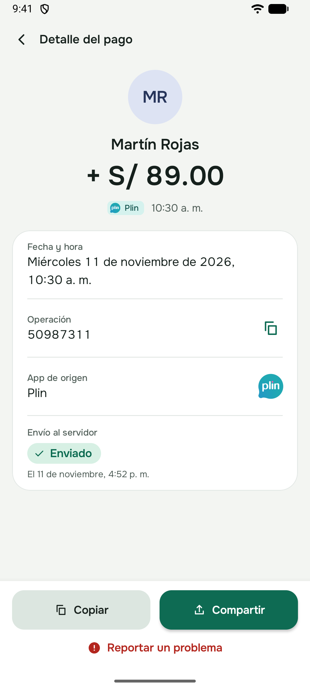
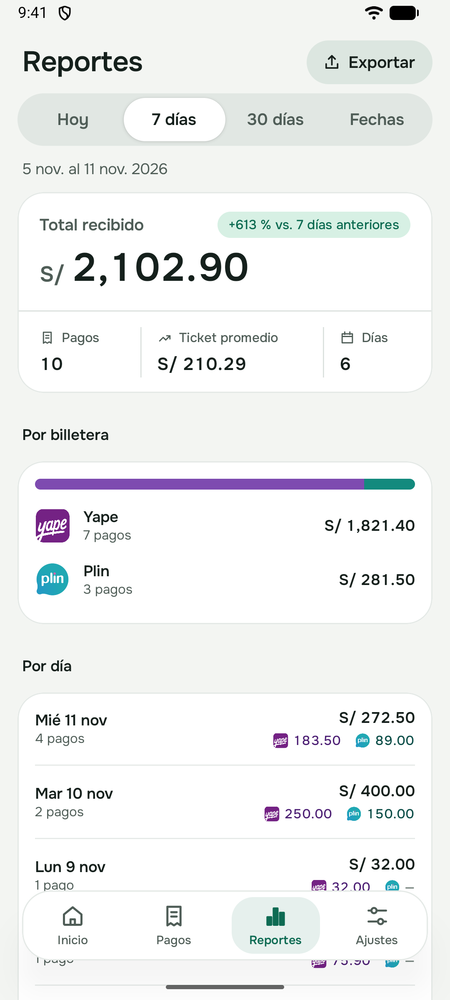
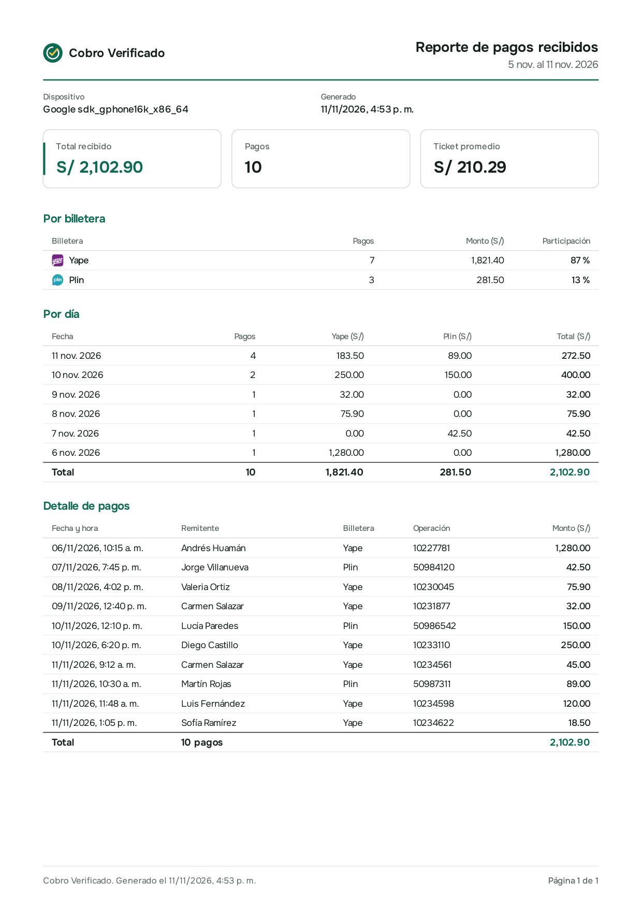
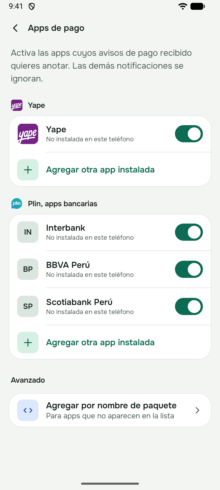

# Cobro Verificado

Verifica las capturas de pago de Yape y Plin que te mandan tus clientes, y te dice si ese pago llegó de verdad.

Una captura sola no prueba nada: se edita en segundos, y hay apps hechas solo para eso. Por eso Cobro Verificado no se queda en leer la imagen. Una app Android, instalada en el celular del negocio, registra los pagos que **realmente** llegan, y el servicio cruza cada captura con esos pagos.

| Inicio | Pagos | Detalle |
|:---:|:---:|:---:|
|  |  |  |

| Reportes | Reporte en PDF | Apps de pago |
|:---:|:---:|:---:|
|  |  |  |

Las capturas usan datos ficticios.

## Qué responde

| Estado | Significa |
|---|---|
| `confirmado` | La captura coincide con un pago que llegó a tu cuenta |
| `pendiente` | Los datos son coherentes, pero ese pago todavía no aparece entre los recibidos |
| `sospechoso` | Algo no cuadra: otro destinatario, una fecha imposible o señales de edición |
| `rechazado` | No sirve: monto distinto, imagen ilegible o un número de operación ya usado |

Cada respuesta trae sus motivos, por ejemplo `operacion_repetida` o `destinatario_ajeno`, para que sepas por qué decidió así. Si configuras un monto límite, los pagos grandes quedan para que una persona los apruebe.

## Cómo funciona

```
Cliente envía la captura
   │
   ▼
API ──► cola en Postgres ──► worker
                               ├─ OCR local (y visión con IA solo si hace falta)
                               ├─ señales de edición
                               ├─ ¿número de operación ya usado?
                               └─ cruce con pagos recibidos ◄── app Android del negocio
                               │
                               ▼
                        veredicto + webhook firmado a tu sistema
```

- **Lectura:** primero OCR local, gratis y rápido. Si no alcanza para leer bien la captura, se pide ayuda a un modelo de visión (Claude), siempre que hayas configurado una clave.
- **Cruce:** la app Android lee las notificaciones de pago **del celular del propio negocio** y se las manda al servicio. Nunca envía el texto completo de la notificación.
- **Defensas:** cada número de operación se puede usar una sola vez, y el envío de la misma captura dos veces se detecta.

## Estructura

```
servicio/   API y worker en Python (FastAPI, PostgreSQL)
android/    app lectora de pagos recibidos (Kotlin, Jetpack Compose)
```

El servicio sigue una arquitectura hexagonal. Las reglas de decisión viven en `dominio/` y no dependen de la base de datos, del OCR ni de la web, así que se prueban sin nada de eso.

## Probarlo

Necesitas Docker.

```bash
cp .env.example .env
```

Genera una clave para cifrar los secretos de los webhooks y pégala en `COBROVERIFICADO_CLAVE_CIFRADO` dentro de `.env`:

```bash
python -c "import secrets; print(secrets.token_hex(32))"
```

Luego levanta todo:

```bash
docker compose up -d --build
```

Si el puerto 8000 está ocupado, define `COBROVERIFICADO_PUERTO` en `.env`.

Crea un comercio. La clave API se muestra una sola vez:

```bash
docker compose exec api python -m cobroverificado.cli crear-comercio "Mi bodega" --destinatario "Juan Perez" --celular 987654321
```

Envía una captura:

```bash
curl -X POST http://localhost:8000/v1/verificaciones \
  -H "Authorization: Bearer TU_CLAVE" \
  -H "Idempotency-Key: pedido-123" \
  -F imagen=@captura.png \
  -F monto_esperado=25.50
```

Responde `202` con el id. El resultado se consulta en `GET /v1/verificaciones/{id}`. Si repites la petición con la misma `Idempotency-Key`, recibes la misma verificación en lugar de una nueva. La documentación interactiva está en `http://localhost:8000/docs`.

Para recibir el resultado en tu sistema, registra tu webhook. La respuesta trae el secreto de firma una sola vez:

```bash
curl -X PUT http://localhost:8000/v1/comercio/webhook \
  -H "Authorization: Bearer TU_CLAVE" \
  -H "Content-Type: application/json" \
  -d '{"url": "https://tu-sistema.com/webhooks/pagos"}'
```

Cada aviso llega con la cabecera `X-Firma: t=<unix>,v1=<hmac>`, el HMAC-SHA256 de `t.cuerpo` con ese secreto. Si se filtra, rótalo con `POST /v1/comercio/webhook/rotar`.

Sin `COBROVERIFICADO_ANTHROPIC_API_KEY` funciona solo con OCR. Con la clave, mejora en capturas difíciles.

## La app Android

La app funciona sola, sin servidor: anota cada pago que recibes, te muestra lo cobrado por día y por billetera, y exporta reportes en PDF o CSV.

1. Instálala en el celular que recibe los pagos del negocio. Ábrela en Android Studio desde `android/` o compílala con `./gradlew assembleDebug`.
2. Dale acceso a las notificaciones; la app explica qué lee y qué guarda.
3. Elige **Empezar sin servidor**, o vincúlala con el servicio para verificar capturas.

Para vincularla, el comercio genera un código con `POST /v1/dispositivos/codigos`, y la app lo recibe escaneando un QR o escribiéndolo a mano. Desde ahí cada pago se envía solo, también sin internet: se manda cuando vuelve la conexión.

Solo lee notificaciones de las apps de pago que elijas, y solo de pagos recibidos. Se puede pausar o desvincular en cualquier momento, y nunca envía el texto completo de la notificación.

## Privacidad

- Las capturas se borran apenas se procesan, y lo que quede se elimina pasadas 24 horas.
- Las claves API y los tokens se guardan como hash.
- Los registros nunca incluyen imágenes, claves ni tokens.
- La app Android solo debe usarse con la cuenta del propio negocio.

Una captura y una notificación contienen datos personales, protegidos en Perú por la Ley 29733. Si lo usas con clientes reales, revisa cómo informas y guardas esos datos.

## Precisión

`servicio/evaluacion/` mide qué tan bien se leen tus capturas. Pon las imágenes con un `.json` que diga los valores correctos en `servicio/evaluacion/capturas/` (esa carpeta no se sube a git) y ejecuta:

```bash
python evaluacion/evaluar.py --detalle
```

Todavía no hay cifras publicadas. Los textos de Yape, Plin y sus notificaciones se escribieron a partir de comprobantes típicos y faltan validar con capturas reales.

## Desarrollo

```bash
cd servicio
uv sync
uv run pytest
uv run ruff check
uv run mypy --strict src
```

```bash
cd android
./gradlew testDebugUnitTest
```

## Contribuir

Las propuestas son bienvenidas. Lee [CONTRIBUTING.md](CONTRIBUTING.md) antes de abrir un pull request.

Lo que más ayuda ahora son ejemplos reales, con los datos tapados, del texto de las notificaciones de Yape y de los bancos que usan Plin.

## Licencia

MIT. Yape y Plin son marcas de sus respectivos dueños; este proyecto no está afiliado a ellos.
